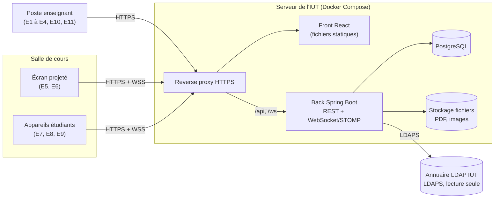
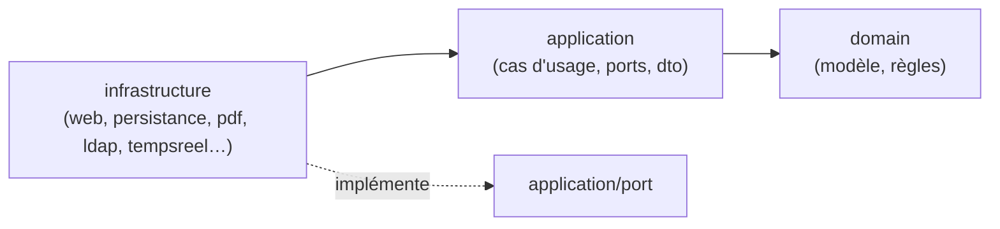
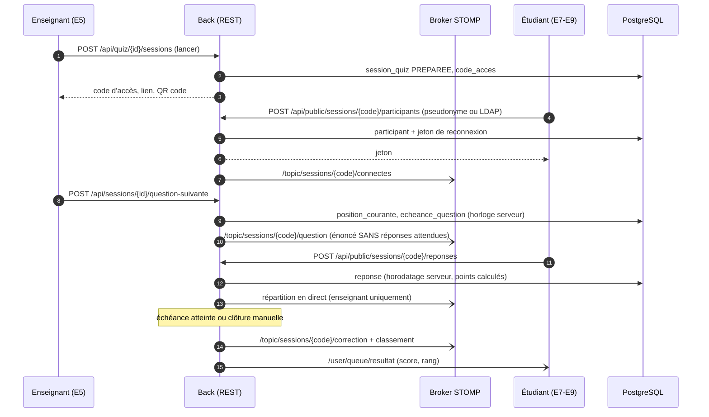

# Architecture du back-end Quizzard

Ce document décrit l'architecture du back-end de **Quizzard**, l'outil de quiz dynamique de l'IUT de Montreuil
(SAÉ 5.01A, BUT 3, 2026-2027). Il complète le dossier de conception et d'architecture technique de l'équipe ;
en cas de désaccord, le dossier de conception fait foi et ce fichier doit être mis à jour.

Documents liés : [DESIGN.md](DESIGN.md) (règles métier et conception détaillée), [API.md](API.md) (contrat REST et
temps réel), [DATABASE.md](DATABASE.md) (schéma PostgreSQL).

---

## 1. Vue d'ensemble

Quizzard permet à un enseignant d'importer un cours PDF, d'y intercaler des pages de quiz et de classement, puis
d'animer ces quiz en direct : les étudiants rejoignent par QR code ou lien depuis leur téléphone, sans compte pour un
quiz non noté, avec leur compte LDAP de l'IUT pour un quiz noté.

Le choix technique vient de l'étude de faisabilité (option 1, développement sur mesure, 54,1 / 67) :

| Brique | Technologie | Rôle |
|---|---|---|
| Front-end | React (dépôt séparé du front) | Application monopage responsive, rendu du PDF avec PDF.js |
| Back-end | **Spring Boot 4.1 / Java 25** (ce dépôt) | API REST, canal temps réel WebSocket (STOMP), règles métier, sécurité |
| Base de données | **PostgreSQL 18** | Cours, versions, quiz, séances, réponses, scores, journal |
| Migrations | **Flyway** | Seule source du schéma (`ddl-auto=validate`) |
| Authentification | Comptes locaux provisoires, puis **annuaire LDAP de l'IUT** (LDAPS, lecture seule) | Enseignants ; étudiants pour les quiz notés |
| Stockage des fichiers | Disque du serveur, hors de l'espace servi au public | PDF importés, images des questions |
| Déploiement | Docker / Docker Compose derrière un reverse proxy HTTPS | Serveur de l'IUT |

Contraintes structurantes (cahier des charges §4) :

- **Hébergement interne, aucune dépendance externe à l'exécution** : pas de CDN, d'API tierce ni de police distante ;
  le QR code est généré par l'application.
- **Temps réel** : réponses reçues affichées en moins de 1 s, classement mis à jour en moins de 2 s après la clôture
  d'une question, jusqu'à **300 participants simultanés** par séance.
- **Intégrité du jeu** : décompte et horodatage côté serveur, une seule réponse par participant et par question,
  réponses attendues jamais envoyées aux étudiants avant la clôture.
- **RGPD** : minimisation, identité jamais projetée (pseudonyme uniquement), purge à échéance.



---

## 2. Architecture logicielle : clean architecture découpée par feature

Le code est organisé **par fonctionnalité métier** (« feature »), et chaque feature est découpée en trois couches
(clean architecture / architecture hexagonale). Le paquet racine est `fr.iutmontreuil.quizzard`.

```text
src/main/java/fr/iutmontreuil/quizzard/
├── SaeS52026QuizzardBackApplication.java
├── features/
│   ├── compte/          UC1, UC15 : connexion enseignant, connexion LDAP des étudiants (quiz noté)
│   ├── cours/           UC2, UC3, UC6, UC11 : import PDF, versions, pages insérées, réapplication des quiz
│   ├── quiz/            UC4, UC5, UC13, UC14 : quiz, questions, barème, déroulé, motifs, images
│   ├── seance/          UC7, UC8, UC9, UC12 : sessions en direct, participants, réponses, temps réel
│   ├── classement/      UC10, UC11, UC12 : classements simples ou cumulés
│   ├── resultat/        UC16, UC17, UC18 : résultats, correction des réponses libres, export CSV
│   └── administration/  RGPD, purge planifiée, fichiers orphelins (UC19, UC20 du dossier de conception)
└── shared/              socle commun : exceptions, journalisation, sécurité, erreurs HTTP
```

Chaque feature suit la même structure :

```text
features/<feature>/
├── domain/                     Modèle métier pur : entités, objets valeur, règles, exceptions métier.
│                               Aucune dépendance à Spring, JPA, HTTP ou à la base.
├── application/
│   ├── port/                   Interfaces dont le domaine a besoin (dépôts, stockage, LDAP, horloge…)
│   ├── dto/                    Commandes et résultats des cas d'usage
│   └── *CasUsage / *Service    Un cas d'usage = une classe qui orchestre domaine + ports
└── infrastructure/
    ├── web/                    Contrôleurs REST, DTO HTTP, validation (@Valid)
    ├── persistance/            Entités JPA, repositories Spring Data, adaptateurs des ports
    └── <technique>/            Adaptateurs spécifiques : pdf/ (cours), ldap/ (compte),
                                tempsreel/ (seance, STOMP), planification/ (administration)
```

### Règle de dépendance



- Le **domaine** ne dépend de rien d'autre que du JDK et de `shared.domain`.
- L'**application** dépend du domaine et déclare ses besoins sous forme de **ports** (interfaces).
- L'**infrastructure** dépend des deux et fournit les implémentations (adaptateurs) des ports.
- Une feature n'accède **jamais** à la couche `infrastructure` d'une autre feature. Si une feature a besoin d'une
  autre (par exemple `seance` lit les questions de `quiz`), elle passe par un port de sa propre couche application,
  implémenté par un adaptateur qui appelle le cas d'usage ou le service applicatif de l'autre feature.

### Le socle `shared`

| Élément | Emplacement | Rôle |
|---|---|---|
| Exceptions métier | `shared/domain/Exception*.java` | Six catégories (`Introuvable` → 404, `Conflit` → 409, `AccesRefuse` → 403, `NonAuthentifie` → 401, `TypeNonSupporte` → 415, `DonneesInvalides` → 422). Chaque feature crée ses exceptions nommées en héritant d'une catégorie. |
| Port de journalisation | `shared/application/port/JournalEvenements.java` | `evenement`, `regleRefusee`, `actionSensible` (cette dernière écrit aussi dans `journal_evenement`). |
| Journalisation HTTP | `shared/infrastructure/journalisation/` | Filtre placé avant Spring Security : `request_id` (MDC + en-tête `X-Request-Id`), une ligne `request_handled` par requête. Logs au format JSON Lines (`logstash`). |
| Sécurité | `shared/infrastructure/securite/SecurityConfig.java` | Refus par défaut, CORS limité à `FRONT_URL`, pas de formulaire ni de Basic ; interrupteur de développement `SECURITE_OUVERTE`. |
| Erreurs HTTP | `shared/infrastructure/web/GestionnaireErreurs.java` | Seul endroit qui associe une exception à un statut HTTP ; forme unique `ReponseErreur`. |
| Prévus | `shared/infrastructure/config`, `persistance`, `stockage` | Configuration commune, classes de base JPA, stockage des fichiers sur disque. |

---

## 3. Flux principaux

### 3.1 Préparer un cours (P1 : UC1 à UC6, UC13, UC14)

1. L'enseignant se connecte (`compte`) : session HTTP côté serveur, cookie `HttpOnly`, CSRF actif.
2. Il importe un PDF (`cours`) : contrôle du type et de la taille (50 Mo, `spring.servlet.multipart`), lecture du
   nombre de pages, empreinte SHA-256 (doublons), stockage sur disque, création du cours et de la version 1.
3. Il crée un quiz et ses questions (`quiz`), puis insère des pages de quiz entre deux pages du PDF (`cours`,
   table `page_inseree`).
4. Lors d'une nouvelle version du PDF, les pages insérées sont **proposées** à la même position (numéro de page +
   repère de texte) et l'enseignant valide l'aperçu (UC6).

### 3.2 Animer un quiz en séance (P2 : UC7 à UC9, UC15)



Principes :

- **Commandes en REST, diffusion en STOMP.** Les actions (rejoindre, répondre, passer à la question suivante)
  passent par l'API REST : validation, format d'erreur et codes HTTP communs, tests simples. Le serveur pousse
  ensuite l'état par WebSocket/STOMP. Voir [API.md](API.md) §4.
- **L'horloge du serveur fait foi** : `echeance_question` est calculée à l'ouverture de la question ; une réponse
  reçue après est refusée. Le front n'affiche qu'un décompte synchronisé sur cette échéance.
- **Clôture automatique** : une tâche planifiée par question (planificateur Spring) clôt la question à l'échéance,
  puis enchaîne les écrans intermédiaires et, si l'option est active, la question suivante.
- **Retardataires et coupures réseau** : un participant reprend sur la question en cours grâce à son jeton de
  reconnexion ; il ne reçoit pas de points pour les questions manquées.

### 3.3 Classements et résultats (P3, P4 : UC10 à UC12, UC16 à UC18)

- Le classement d'une séance se calcule à partir de `participant.score_total`, mis à jour à chaque réponse.
- Un classement cumulé (`classement` + `classement_quiz`) additionne les scores de plusieurs quiz, y compris de
  cours différents. Les participants sont reconnus par identifiant LDAP en quiz noté, par pseudonyme identique
  (au mieux) en quiz non noté.
- La correction des réponses libres se fait **après** la séance ; une décision s'applique à toutes les réponses qui
  ont le même texte normalisé (`correction`), puis les scores et les classements sont recalculés.
- L'export CSV est une action sensible journalisée.

---

## 4. Temps réel

- Spring WebSocket avec **STOMP** (dépendance `spring-boot-starter-websocket` déjà présente), point d'entrée `/ws`.
- Broker simple en mémoire de Spring : une seule instance du back est prévue. Si l'application devait passer à
  plusieurs instances, il faudrait un broker externe (RabbitMQ STOMP) et des sessions partagées.
- Les messages ne transportent jamais les réponses attendues avant la clôture, ni l'identité d'un étudiant.
- Objectif de charge à vérifier par un test de charge (cahier de recette) : 300 connexions, 300 réponses en quelques
  secondes, diffusion de la répartition en moins de 1 s.

## 5. Sécurité

| Sujet | Décision |
|---|---|
| Authentification enseignant | Comptes locaux (empreinte BCrypt, `origine_compte = LOCAL`) pendant les premiers sprints, puis LDAP (`LDAP`, aucun mot de passe conservé). L'accès passe par un port `compte/application/port` pour pouvoir changer d'implémentation sans toucher aux cas d'usage. |
| Session | Session HTTP côté serveur, cookie `HttpOnly`, `Secure`, `SameSite`, expiration après inactivité. |
| CSRF | Actif pour les routes authentifiées (jeton lu par le front React). Désactivé seulement avec `SECURITE_OUVERTE=true`. |
| Étudiants | Sans compte : jeton de participant propre à la session, invalidé à la clôture. Quiz noté : authentification LDAP, rôle étudiant exigé. |
| Contrôle d'accès | Chaque cours, quiz, classement et séance n'est accessible qu'à son enseignant propriétaire (vérifié dans le cas d'usage, pas seulement dans le contrôleur). |
| CORS | Seule l'origine `FRONT_URL` est autorisée, cookies compris. |
| Abus | Limitation des tentatives de connexion et du nombre de connexions par appareil. |
| Fichiers | Type et taille contrôlés, stockage hors de l'espace public, PDF servi seulement par une route protégée. |
| Motifs (regex) | Exécution avec limite de temps et de longueur, moteur à temps linéaire de préférence (voir [DESIGN.md](DESIGN.md)). |
| Journal | Connexions et actions sensibles (import, suppression, lancement, correction, export) dans `journal_evenement`, conservées 6 mois. Aucune donnée personnelle dans les logs applicatifs. |

L'interrupteur `SECURITE_OUVERTE` (fichier `.env`) ouvre toutes les routes pour le développement tant que la feature
`compte` n'existe pas. Il ne doit **jamais** être activé sur le serveur et sera supprimé une fois la connexion faite.

## 6. Configuration et environnements

| Variable | Défaut | Usage |
|---|---|---|
| `DB_NAME`, `DB_USER`, `DB_PASSWORD` | `quizzard` | Base PostgreSQL de développement (`compose.yaml`) |
| `DB_PORT` | `5433` | Port côté machine (le 5432 est souvent déjà pris) |
| `FRONT_URL` | `http://localhost:5173` | Origine autorisée par CORS |
| `SECURITE_OUVERTE` | `false` | Développement uniquement |

- En développement, `spring-boot-docker-compose` démarre PostgreSQL au lancement de l'application.
- En test, **Testcontainers** démarre un PostgreSQL 18 (`TestcontainersConfiguration`) : Docker est nécessaire.
- En production, la configuration passe par des variables d'environnement du conteneur ; aucun secret n'est commité.

## 7. Déploiement (cible)

- Image Docker du back (JRE 25), image du front servie en statique, PostgreSQL, reverse proxy HTTPS (WebSocket
  compris), le tout décrit dans un Docker Compose de production.
- Volumes persistants pour la base et le stockage des fichiers ; sauvegarde quotidienne.
- Sonde de santé : `GET /actuator/health` (route publique).
- Mise à jour sans interrompre une séance en cours : déploiement hors des plages de cours (8 h – 20 h en semaine).
- Guide d'installation rédigé en anglais (livrable du Sprint 4).

## 8. Décisions d'architecture

| # | Décision | Raison |
|---|---|---|
| D1 | Spring Boot plutôt que reprise d'un projet open source ou SaaS | Étude de faisabilité : couverture fonctionnelle, hébergement interne, objectifs de la SAÉ |
| D2 | Découpage par feature + clean architecture | Rotation des rôles à chaque sprint : chaque feature se lit et se teste seule |
| D3 | Schéma géré par Flyway, Hibernate en `validate` | Schéma versionné, relu et identique sur tous les postes |
| D4 | Commandes en REST, diffusion en STOMP | Format d'erreur et validation communs ; temps réel seulement là où il sert |
| D5 | Horloge et calcul des scores côté serveur | Intégrité du jeu |
| D6 | Authentification derrière un port | LDAP intégré dans un second temps, sans réécrire les cas d'usage |
| D7 | Logs JSON sans donnée personnelle, journal des actions sensibles en base | RGPD et traçabilité |
