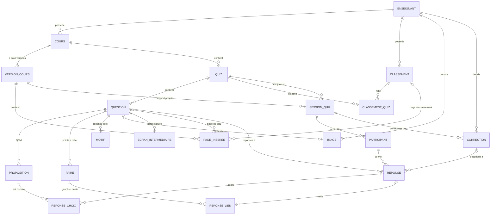

# Base de données

Le back-end utilise **PostgreSQL 18**. Le schéma est créé et versionné **uniquement par Flyway**
(`src/main/resources/db/migration`) ; Hibernate se contente de vérifier que les entités correspondent aux tables
(`spring.jpa.hibernate.ddl-auto=validate`).

Source du schéma : dossier de conception et d'architecture technique, §3.2 (MLD, 20 tables) et §3.2.3 (dictionnaire
des données). Migration actuelle : [`V1__schema_initial.sql`](../src/main/resources/db/migration/V1__schema_initial.sql).

---

## 1. Conventions

- **Noms en `snake_case`**, sans guillemets. C'est la stratégie de nommage par défaut de Spring/Hibernate :
  l'attribut Java `idEnseignant` correspond à la colonne `id_enseignant`.
- **Clés primaires** `BIGINT GENERATED BY DEFAULT AS IDENTITY`, nommées `id_<table>` (`id_cours`, `id_quiz`…).
- **Listes de valeurs** : colonnes texte avec une contrainte `CHECK` (pas de type `ENUM` PostgreSQL), mappées en
  `@Enumerated(EnumType.STRING)` côté Java.
- **Nommage des contraintes** : `uq_<table>_<objet>` (unicité), `ck_<table>_<objet>` (vérification),
  `ix_<table>_<colonne>` (index).
- **Clés étrangères indexées** (PostgreSQL ne le fait pas tout seul), sauf quand un index unique ou une clé primaire
  commence déjà par la colonne.
- **Suppression** : seule la suppression d'une `session_quiz` est en cascade (participants, réponses, choix, liens,
  corrections) pour la purge RGPD. Les autres clés étrangères refusent la suppression (`NO ACTION`) : on archive
  (`archive`, `archivee`) au lieu de supprimer.
- **Dates** en `TIMESTAMP` (heure du serveur).
- Les contraintes qui portent sur plusieurs associations (même cours, même enseignant, même question…) sont
  vérifiées par le back-end, dans le domaine.

## 2. Règles Flyway

1. **Une migration déjà poussée sur `develop` ne se modifie jamais.** Toute évolution passe par un nouveau fichier.
2. Nommage : `V<n>__<description_en_snake_case>.sql`, numéros consécutifs (`V2__ajout_type_vrai_faux.sql`).
3. Une migration par sujet, commentée en tête (but, ticket Jira, UC concerné).
4. Avant de pousser : lancer les tests (Testcontainers applique toutes les migrations sur une base vierge, puis
   Hibernate valide les entités).
5. Deux branches qui créent le même numéro de version : la seconde à fusionner renumérote la sienne.
6. Données de démonstration : pas dans les migrations de schéma. Elles iront dans un jeu de données séparé
   (profil `demo` ou script dédié).

## 3. Modèle de données



`journal_evenement` n'a aucune clé étrangère : il est purgé indépendamment des autres tables.

## 4. Dictionnaire des tables

### 4.1 Cours, versions, quiz et classements

| Table | Rôle | Points clés |
|---|---|---|
| `enseignant` | Compte enseignant ou administrateur | `identifiant_ldap` unique ; `origine_compte` `LDAP` ou `LOCAL` ; `role` `ENSEIGNANT` ou `ADMINISTRATEUR` ; `mot_de_passe_hash` (BCrypt) **seulement** pour un compte `LOCAL` (`ck_enseignant_mot_de_passe`). |
| `cours` | Cours d'un enseignant | `titre` non vide ; `archive` ; `date_modification` mise à jour à chaque changement. |
| `version_cours` | Une version importée du PDF | `numero` ≥ 1, unique par cours ; `empreinte` SHA-256 (64 caractères hexadécimaux) pour détecter les doublons ; `chemin_stockage` NULL **si et seulement si** `date_suppression_fichier` est renseignée (fichier supprimé par l'administrateur). |
| `quiz` | Quiz rattaché au cours (pas à une version) | `est_note` ; `duree_par_defaut_sec` > 0 ; `passage_automatique` + `delai_passage_auto_sec` ; `affichage_cours` `PROJETE_SEUL` ou `AUSSI_ETUDIANTS` (point ouvert n° 8 du cahier des charges). |
| `classement` | Classement d'un enseignant | `nom` unique par enseignant. |
| `classement_quiz` | Quiz reliés à un classement | Clé primaire composée ; un classement cumulé relie plusieurs quiz, éventuellement de cours différents. |

### 4.2 Questions et contenu attendu

| Table | Rôle | Points clés |
|---|---|---|
| `question` | Une question (une page de quiz) | `type` `QCM`, `POINTS_A_RELIER`, `REPONSE_LIBRE` (les types COULD élargiront la contrainte par migration) ; `duree_sec` NULL = durée par défaut du quiz ; barème : `points_max` (1000 par défaut), `decroissance_temps`, `points_partiels` ; `verrouillee` dès qu'une séance a utilisé la question ; `archivee`. |
| `proposition` | Proposition d'un QCM | `est_correcte`, `rang` d'affichage. |
| `paire` | Paire attendue d'une question « points à relier » | `element_gauche`, `element_droit`. |
| `motif` | Motif accepté pour une réponse libre | `mode_motif` `SIMPLE` ou `REGEX`. |
| `image` | Image d'une question | PNG, JPEG ou WebP ; au plus une image par question (`id_question` unique) ; `id_question` NULL = image orpheline (nettoyée par l'administration) ; même règle fichier/date de suppression que `version_cours`. |
| `ecran_intermediaire` | Écran affiché après la clôture d'une question | `type_ecran` `BONNE_REPONSE`, `REPARTITION`, `CLASSEMENT` ; `rang` ; `delai_apres_cloture_sec` ; `parametres` en `JSONB`. |

### 4.3 Pages insérées

| Table | Rôle | Points clés |
|---|---|---|
| `page_inseree` | Page de quiz ou de classement intercalée dans une version du cours | Ancrée par `numero_page` (0 = avant la première page) + `repere_texte` + `ordre` (plusieurs pages au même endroit) ; **soit** `id_question` **soit** `id_classement` (`num_nonnulls = 1`) ; une question n'apparaît qu'une fois par version ; `valide` = position confirmée par l'enseignant après réapplication (UC6). |

### 4.4 Séances et résultats

| Table | Rôle | Points clés |
|---|---|---|
| `session_quiz` | Une séance (un quiz joué en direct) | `code_acces` unique (lien et QR code) ; `etat` `PREPAREE` → `EN_COURS` → `CLOTUREE` ; `est_notee` figé au lancement ; `position_courante` et `echeance_question` (horloge serveur) ; liée à la version du cours projetée. |
| `participant` | Étudiant dans une séance | `pseudonyme` 2 à 20 caractères, unique dans la séance ; identité (`identifiant_ldap`, `nom`, `prenom`) **seulement en quiz noté** ; `identite_verifiee` faux pour une entrée « identité non vérifiée » ; `score_total` ; `jeton_reconnexion` unique sur 64 caractères (recommandation : y ranger l'empreinte SHA-256 du jeton plutôt que le jeton en clair) ; `derniere_activite`. Cascade depuis la séance. |
| `reponse` | Réponse d'un participant à une question | **Une seule** par participant et par question (`uq_reponse_participant_question`) ; `horodatage_serveur`, `temps_reponse_ms` ; `points_calcules` (au moment de la réponse) et `points_finaux` (après correction) ; `statut_correction` `SANS_OBJET`, `ACCEPTEE_PAR_MOTIF`, `A_EXAMINER`, `VALIDEE`, `REFUSEE`. |
| `reponse_choix` | Propositions cochées (QCM) | Clé primaire `(id_reponse, id_proposition)`. |
| `reponse_lien` | Liens tracés (points à relier) | Un élément de gauche et un élément de droite ne sont reliés qu'une fois par réponse. |
| `correction` | Décision manuelle sur un texte de réponse libre | Unique par `(séance, question, texte_normalise)` : une décision s'applique à toutes les réponses identiques ; `decision` `VALIDEE` ou `REFUSEE` ; enseignant et date journalisés. |

### 4.5 Journal

| Table | Rôle | Points clés |
|---|---|---|
| `journal_evenement` | Connexions et actions sensibles | Écrit par `JournalEvenements.actionSensible` ; `type_action` ≤ 30 caractères (snake_case au passé : `cours_importe`) ; `acteur`, `cible`, `adresse_ip`, `details` (JSON) ; index sur `date_heure` pour la purge. |

## 5. Conservation des données (RGPD)

Durées proposées dans le cahier des charges, **à valider avec le délégué à la protection des données** de l'IUT :

| Données | Durée | Mise en œuvre |
|---|---|---|
| Séances d'un quiz non noté | 3 mois après la clôture | Suppression de la `session_quiz` (cascade) par une tâche planifiée (`administration/infrastructure/planification`) |
| Séances d'un quiz noté | 12 mois après la clôture | Idem |
| Journal des événements | 6 mois | Suppression par `date_heure` |
| Fichiers PDF et images | Tant que le cours ou la question existe | Suppression du fichier par l'administrateur, la ligne garde `date_suppression_fichier` |

Les droits d'accès, de rectification et d'effacement d'un participant se traitent par l'administrateur ou
l'enseignant propriétaire (suppression d'un participant ou d'une séance).

## 6. Développement local

```bash
docker compose up -d
```

Ce n'est en général pas nécessaire : `spring-boot-docker-compose` démarre la base au lancement de l'application.
Connexion : `localhost:5433`, base, utilisateur et mot de passe `quizzard` (modifiables dans `.env`).

Repartir d'une base vierge (efface toutes les données locales) :

```bash
docker compose down -v
```

## 7. Évolutions prévues

- Types de questions COULD (vrai/faux, remise dans l'ordre, sondage…) : migration qui élargit `ck_question_type`
  et ajoute les tables de contenu nécessaires.
- Pénalités et bonus de série (COULD) : colonnes de barème supplémentaires sur `question`.
- Index complémentaires après le test de charge (lecture des réponses d'une question pendant une séance).
