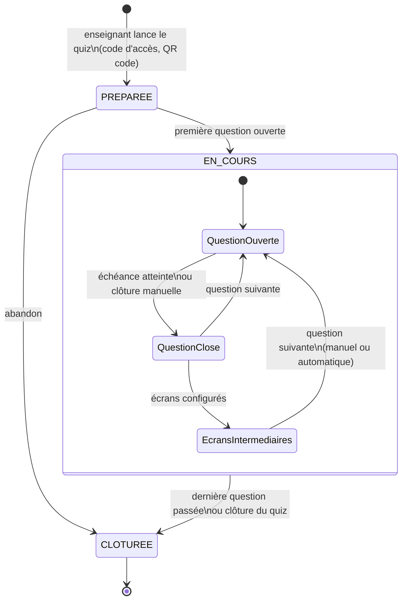
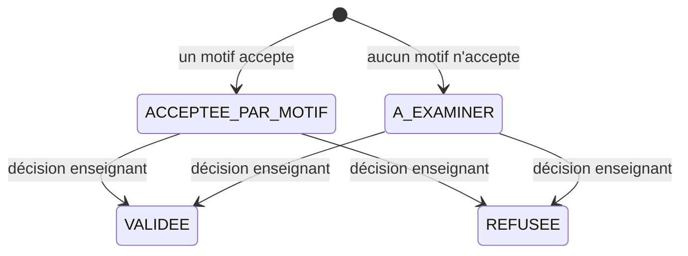

# Conception détaillée du back-end

Ce document décrit **comment** le back-end applique les règles du cahier des charges : modèle métier, calcul des
scores, cycle de vie d'une séance, correction des réponses libres, réapplication des quiz, et conventions de code.
L'organisation des paquets est dans [ARCHITECTURE.md](ARCHITECTURE.md), le schéma dans [DATABASE.md](DATABASE.md).

Les règles marquées **(à valider)** sont des propositions de l'équipe qui attendent une réponse du client
(A. Bossard) ou de M. Groff.

---

## 1. Modèle métier par feature

| Feature | Agrégats et objets principaux | Invariants portés par le domaine |
|---|---|---|
| `compte` | `Enseignant` (origine `LDAP`/`LOCAL`, rôle), `IdentiteEtudiant` (quiz noté) | Un compte étudiant n'ouvre jamais l'espace enseignant ; aucun mot de passe LDAP conservé. |
| `cours` | `Cours` → `VersionCours` → `PageInseree` | Un cours n'est visible que par son enseignant ; numéros de version consécutifs ; une page insérée porte une question **ou** un classement. |
| `quiz` | `Quiz` → `Question` (+ `Proposition`, `Paire`, `Motif`, `Image`, `EcranIntermediaire`), `Bareme` | Une question complète est exigée pour lancer le quiz ; une question utilisée en séance est verrouillée. |
| `seance` | `Session` → `Participant` → `Reponse` | Une réponse par participant et par question ; aucune réponse hors délai ; mode noté figé au lancement. |
| `classement` | `Classement` (quiz reliés), `LigneClassement` (calculée) | Seuls les quiz de l'enseignant sont reliés ; au moins un quiz. |
| `resultat` | `ResultatSeance`, `Correction`, `ExportCsv` | Correction après la séance seulement ; la décision manuelle prime sur les motifs. |
| `administration` | Purge, fichiers orphelins, demandes RGPD | Durées de conservation (§7). |

Les objets du domaine sont des classes Java simples (records pour les objets valeur). Les entités JPA vivent dans
`infrastructure/persistance` et sont converties vers ou depuis le domaine par l'adaptateur du dépôt.

## 2. Types de questions

| Type | Priorité | Saisie enseignant | Réponse étudiant | Validité minimale |
|---|---|---|---|---|
| `QCM` | MUST | Propositions + cases « bonne réponse » | Propositions cochées | 2 propositions, au moins 1 correcte |
| `POINTS_A_RELIER` | SHOULD | Paires (gauche, droite) | Liens gauche → droite | 2 paires |
| `REPONSE_LIBRE` | SHOULD | Motifs acceptés (simple ou regex) | Texte (1000 caractères au plus) | 1 motif |
| Vrai/faux, remise dans l'ordre, sondage, nuage de mots… | COULD | À définir | À définir | À valider avec le client |

Les réponses attendues (`est_correcte`, paires, motifs) **ne quittent jamais le serveur avant la clôture** de la
question : les DTO envoyés aux étudiants et à l'écran projeté pendant la question ne contiennent que l'énoncé, les
libellés et, pour les points à relier, les deux colonnes mélangées.

## 3. Calcul des scores (UC9, UC13)

### 3.1 Barème d'une question

- `points_max` : 1000 par défaut (bornes à fixer).
- `decroissance_temps` : si vrai, les points baissent avec le temps de réponse, façon Kahoot.
- `points_partiels` : si vrai, une réponse partiellement juste rapporte une part des points.

### 3.2 Formule

```text
facteurTemps = decroissance_temps ? 1 − (t / T) / 2 : 1
points       = arrondi( points_max × tauxReussite × facteurTemps )
```

- `t` = temps de réponse en millisecondes, mesuré **par le serveur** entre l'ouverture de la question et la
  réception de la réponse ; `T` = durée de la question (`question.duree_sec`, sinon `quiz.duree_par_defaut_sec`).
- `t` est borné à `[0, T]` : une réponse instantanée vaut 100 % des points, une réponse à la dernière milliseconde
  en vaut 50 %.
- `arrondi` = arrondi à l'entier le plus proche (`Math.round`).

### 3.3 Taux de réussite

| Type | Sans points partiels | Avec points partiels |
|---|---|---|
| `QCM` | 1 si les propositions cochées sont exactement les correctes, sinon 0 | `max(0, (bonnes cochées − mauvaises cochées) / nombre de bonnes)` |
| `POINTS_A_RELIER` | 1 si toutes les paires sont justes, sinon 0 | `paires justes / nombre de paires` |
| `REPONSE_LIBRE` | Tout ou rien : 1 si un motif accepte la réponse ou si l'enseignant l'a validée | Idem (pas de points partiels) |

Pas de réponse avant l'échéance : aucune ligne `reponse`, 0 point. Pénalités et bonus de série sont COULD (§9).

### 3.4 Exemples (tests unitaires attendus)

| Cas | Barème | Résultat |
|---|---|---|
| QCM juste en 0 s sur 20 s | 1000, décroissance | 1000 |
| QCM juste en 10 s sur 20 s | 1000, décroissance | 750 |
| QCM juste en 20 s sur 20 s | 1000, décroissance | 500 |
| QCM juste en 15 s, sans décroissance | 1000 | 1000 |
| QCM à 3 bonnes réponses : 2 bonnes et 1 mauvaise cochées, en 0 s | 1000, partiels | 333 |
| Relier 3 paires justes sur 4, en 0 s | 1000, partiels | 750 |
| Relier 3 sur 4, sans partiels | 1000 | 0 |

### 3.5 Points calculés et points finaux

- `points_calcules` : calculés à la réception, jamais modifiés ensuite.
- `points_finaux` : égaux aux points calculés, puis recalculés après une correction manuelle (réponse libre).
- `participant.score_total` = somme des `points_finaux` du participant ; mis à jour dans la **même transaction** que
  l'enregistrement de la réponse.

## 4. Cycle de vie d'une séance (UC7, UC8, UC9, UC14)



Règles :

1. Seul l'enseignant propriétaire lance, fait avancer et clôt une séance.
2. Un quiz ne peut être lancé que si toutes ses questions sont complètes ; ses questions sont alors verrouillées
   (`question.verrouillee`) : les modifier n'altère pas les séances passées.
3. Le mode noté (`session_quiz.est_notee`) est copié du quiz au lancement et ne change plus.
4. À l'ouverture d'une question : `position_courante` avance, `echeance_question = maintenant + durée`. Une tâche
   planifiée clôt la question à l'échéance.
5. Une réponse est **refusée** (409) si la séance n'est pas `EN_COURS`, si la question n'est pas la question ouverte,
   si l'échéance est dépassée ou si le participant a déjà répondu. La contrainte unique en base est le dernier
   rempart contre les doubles envois simultanés.
6. Passage automatique (option) : après la clôture et les écrans intermédiaires, la question suivante s'ouvre après
   `delai_passage_auto_sec`.
7. À la clôture de la séance, le code d'accès et les jetons de participants sont invalidés.

### Rejoindre une séance

| Mode | Étapes | Règles |
|---|---|---|
| Non noté | Lien ou QR code → pseudonyme → entrer | Pseudonyme 2 à 20 caractères, unique dans la séance (un autre est proposé en cas de doublon) ; aucun compte. |
| Noté | Lien ou QR code → identifiant + mot de passe IUT → entrer | Rôle étudiant exigé ; un pseudonyme d'affichage est proposé ; une nouvelle connexion du même compte remplace la précédente. |
| Noté, annuaire indisponible | L'enseignant autorise l'entrée « identité non vérifiée » | Nom et identifiant saisis, `identite_verifiee = false`, signalés dans les résultats et l'export. |

- Arrivée en retard : le participant rejoint la question en cours, sans points pour les questions manquées.
- Coupure réseau : le front renvoie son jeton de reconnexion ; le participant retrouve la question en cours et ses
  réponses déjà confirmées.
- Le nombre de connexions par appareil et de tentatives LDAP est limité.

## 5. Réponses libres et motifs (UC4, UC9, UC16)

### Normalisation

Avant toute comparaison, le texte est normalisé : suppression des espaces en début et en fin, espaces multiples
réduits à un seul, passage en minuscules, accents conservés **(à valider)**. Le texte normalisé est celui qui
regroupe les réponses identiques dans `correction.texte_normalise`.

### Motifs

| Mode | Comportement |
|---|---|
| `SIMPLE` | Égalité avec le texte normalisé ; `*` remplace n'importe quelle suite de caractères **(à valider)**. |
| `REGEX` | Expression régulière appliquée au texte normalisé, sur toute la chaîne. |

Protection du serveur (cahier des charges §4.3) :

- Motif de 500 caractères au plus, réponse de 1000 caractères au plus.
- Moteur d'expressions régulières **à temps linéaire** (RE2/J) plutôt que `java.util.regex`, pour qu'un motif
  pathologique ne bloque pas le serveur ; à défaut, exécution avec délai maximal.
- Le motif est compilé et testé à l'enregistrement (`POST /api/questions/{id}/motifs/test`) : un motif invalide est
  refusé (422).

### Statuts de correction



Les questions qui ne sont pas des réponses libres ont le statut `SANS_OBJET`.

- Pendant la séance, la correspondance par motifs donne des points **provisoires**.
- Après la séance, l'enseignant valide ou refuse chaque groupe de réponses identiques ; la décision prime sur les
  motifs, elle est journalisée (`correction`, `journal_evenement`).
- Ajouter un motif après coup l'applique aux réponses `A_EXAMINER` de la séance.
- « Enregistrer et recalculer » met à jour `points_finaux`, `score_total` et les classements.
- Un quiz noté ne doit pas servir à l'évaluation tant qu'il reste des réponses `A_EXAMINER` : les résultats l'indiquent.

## 6. Réapplication des quiz sur une nouvelle version (UC6)

Les quiz sont liés au **cours**, pas à une version ; seules les `page_inseree` sont liées à une version.

1. L'enseignant importe une nouvelle version : `version_cours.numero + 1`.
2. Le back propose, pour chaque page insérée de la version précédente, une position dans la nouvelle :
   - même `numero_page` si la page existe encore et que le `repere_texte` (texte de la page qui précède) y figure ;
   - sinon, recherche du repère de texte dans les pages voisines ;
   - sinon, position conservée mais marquée à vérifier.
3. Les pages proposées sont créées avec `valide = false` ; l'enseignant voit l'aperçu, ajuste puis valide.
4. Aucun quiz n'est supprimé ni déplacé sans validation de l'enseignant.

La règle exacte de repérage (taille du repère, tolérance) est à confirmer par un prototype.

## 7. Classements (UC10 à UC12)

- **Classement de séance** : participants triés par `score_total` décroissant ; à égalité, la somme des temps de
  réponse la plus faible passe devant **(à valider)**, puis l'ordre d'arrivée.
- **Classement cumulé** : somme des scores des quiz reliés. Identification d'un même étudiant : `identifiant_ldap`
  en quiz noté ; pseudonyme identique (au mieux) en quiz non noté.
- **Évolution** : chaque ligne indique les places gagnées ou perdues depuis la question précédente, avec un symbole
  pour ne pas dépendre de la couleur.
- **Confidentialité** : l'écran projeté et la page de classement n'affichent que pseudonymes et scores ; l'étudiant
  ne reçoit que son propre rang.

## 8. Résultats et export (UC17, UC18)

- Par question : taux de réussite, répartition des réponses, temps moyen.
- Par participant : rang, pseudonyme (ou identité en quiz noté, visible du seul enseignant propriétaire), score,
  détail des réponses, marque « identité non vérifiée ».
- Export CSV : UTF-8 avec BOM (ouverture correcte dans Excel), séparateur `;`, une ligne par participant et une
  colonne par question **(à valider)**. L'export est une action sensible journalisée.

## 9. Fonctions COULD (plus tard)

- Pénalité pour mauvaise réponse : points négatifs bornés, total de séance jamais négatif.
- Bonus de série de bonnes réponses.
- Nouveaux types de questions (§2).
- Deux modes d'affichage du cours en séance (`quiz.affichage_cours`).

## 10. Conventions de code

### Langue et nommage

- **Code métier en français** : classes, méthodes, variables, tables (`Cours`, `importerCours`, `score_total`).
  Les termes techniques imposés restent en anglais (`Controller`, `Repository`, `Config`, `Dto` en suffixe).
- Classes : `PascalCase` ; méthodes et variables : `camelCase` ; constantes : `MAJUSCULES_AVEC_TIRETS_BAS`.
- Tests : méthodes en `snake_case` qui décrivent le comportement (`une_reponse_hors_delai_est_refusee`).
- Événements de journal : `snake_case` au passé (`cours_importe`, `session_lancee`), 30 caractères au plus pour une
  action sensible.

### Couches

- Contrôleur : traduit HTTP ↔ DTO, valide la forme (`@Valid`), appelle **un** cas d'usage. Aucune règle métier.
- Cas d'usage : une classe par intention (`ImporterCours`, `RepondreQuestion`), reçoit ses ports par constructeur,
  porte la transaction (`@Transactional`) et vérifie le propriétaire.
- Domaine : règles et invariants ; lève des exceptions métier nommées (`CoursIntrouvableException extends
  ExceptionIntrouvable`).
- Adaptateurs : implémentent les ports, convertissent entités JPA ↔ domaine.
- Injection par constructeur uniquement (pas de `@Autowired` sur un champ dans le code de production).
- Classes de configuration et adaptateurs en visibilité paquet quand c'est possible.

### Erreurs

- Ne jamais créer de nouvelle correspondance exception → statut HTTP : hériter d'une catégorie de `shared.domain`.
- Les messages d'erreur sont lus par l'utilisateur : en français, clairs, **sans donnée personnelle** (identifiants
  techniques seulement).

### Journalisation

- Utiliser le port `JournalEvenements` dans les cas d'usage, jamais un logger directement.
- Jamais de nom, de pseudonyme, d'e-mail, de mot de passe, de texte de réponse ni de contenu de fichier dans les logs.
- `actionSensible` pour : connexion, import, suppression, archivage, lancement de séance, correction, export.

### Tests

| Couche | Type | Outils |
|---|---|---|
| Domaine | Tests unitaires purs (calcul des scores, normalisation, états) | JUnit 5, AssertJ |
| Application | Cas d'usage avec ports simulés | JUnit 5, doublures écrites à la main ou Mockito |
| Infrastructure web | Contrôleurs, sécurité, format des erreurs | `@SpringBootTest` + MockMvc |
| Persistance | Dépôts et migrations | Testcontainers PostgreSQL 18 |
| Temps réel | Diffusion STOMP | Client STOMP de test |
| Charge | 300 participants | Script de charge (cahier de recette) |
